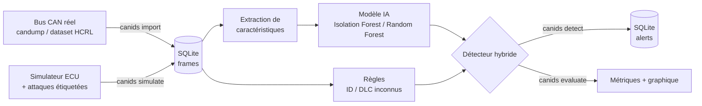
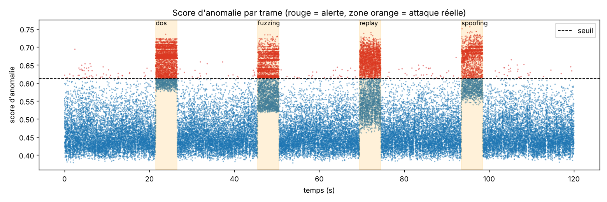

# can-ids-ai — Détection d'anomalies sur le bus CAN par IA


Système de détection d'intrusion (IDS) pour la **sécurité des véhicules intelligents** : les trames
CAN sont stockées dans une **base de données SQLite**, puis un **modèle d'IA** détecte les comportements
anormaux et les attaques (DoS, fuzzing, rejeu, usurpation).

> Le bus CAN n'a ni authentification ni chiffrement : n'importe quel nœud compromis (OBD-II, infotainment,
> télématique) peut injecter des trames. Un IDS comportemental est une contre-mesure complémentaire
> (cf. `docs/threat_model.md`).

## Architecture



## Installation

```bash
git clone https://github.com/<achourayoub76-afk>/can-ids-ai.git
cd can-ids-ai
python -m venv .venv && source .venv/bin/activate
pip install -e ".[dev]"
pytest -q            # 6 tests
```

## Démarrage rapide (≈ 1 minute)

```bash
canids simulate                                   # sessions train / labeled / test dans data/can.db
canids stats
canids train    --model iforest --out models/iforest.joblib   # non supervisé (trafic normal seul)
canids evaluate --model models/iforest.joblib --plot reports/iforest_test.png
canids detect   --model models/iforest.joblib     # écrit les alertes dans la table `alerts`

canids train    --model rf --out models/rf.joblib              # supervisé (trames étiquetées)
canids evaluate --model models/rf.joblib
```

Exemple de requête sur les alertes :

```sql
SELECT f.ts, printf('0x%03X', f.can_id) AS id, a.score, a.reason
FROM alerts a JOIN frames f ON f.id = a.frame_id
ORDER BY a.score DESC LIMIT 20;
```

## Fonctionnement

### Base de données (`src/canids/db.py`)
| Table | Contenu |
|---|---|
| `frames` | `session, ts, can_id, dlc, data (BLOB), label (0/1/NULL), attack_type` |
| `alerts` | `frame_id → frames.id, model, score, reason, created_at` |

### Caractéristiques par trame (`src/canids/features.py`)
| Caractéristique | Intuition |
|---|---|
| `dt_any_log` | temps depuis la trame précédente (charge du bus) |
| `dt_dev` | écart de cadence du même ID vs. sa période nominale (rejeu, injection) |
| `rate_50ms` | trames/s sur 50 ms (DoS) |
| `win_entropy` | entropie des ID sur 64 trames (DoS, fuzzing) |
| `ham_prev` | distance de Hamming avec le payload précédent du même ID |
| `max_byte_z` | écart du payload au profil normal de cet ID (usurpation de valeurs) |

### Détecteur hybride (`src/canids/models.py`)
1. **Règles** : ID ou DLC jamais vus à l'entraînement → alerte.
2. **IA** : `iforest` (Isolation Forest, entraîné **uniquement sur du trafic normal**, seuil = quantile 99,5 % des scores d'entraînement) ou `rf` (Random Forest supervisé).
3. Alerte finale = règles **OU** modèle.

### Attaques simulées (`src/canids/simulator.py`)
| Attaque | Description |
|---|---|
| `dos` | flot de trames à l'ID `0x000` (priorité maximale) |
| `fuzzing` | ID et payload aléatoires |
| `replay` | rejeu de trames légitimes capturées plus tôt |
| `spoofing` | ID légitime (régime moteur) avec une valeur forcée à 7000 tr/min |

## Résultats (données simulées, session `test`, 120 s, graine 42)

| Modèle | Rappel global | Précision | Faux positifs hors attaque |
|---|---|---|---|
| Isolation Forest + règles | 0,94 | 0,79 | 0,44 % |
| Random Forest + règles | 0,996 | 0,90 | 0,06 % |

Rappel par type d'attaque :

| Attaque | Règles seules | Isolation Forest + règles | Random Forest + règles |
|---|---|---|---|
| dos | 1,00 | 1,00 | 1,00 |
| fuzzing | 1,00 | 1,00 | 1,00 |
| replay | 0,00 | 0,55 | 0,97 |
| spoofing | 0,00 | 1,00 | 1,00 |



**À lire avant d'interpréter ces chiffres :**
- Les données sont **synthétiques** : elles valident la chaîne de bout en bout, pas la performance en conditions réelles. Testez sur de vraies captures (voir `data/README.md`).
- Le rejeu est l'attaque la plus difficile pour le modèle non supervisé : la trame injectée est identique à une trame légitime, seule la cadence trahit l'attaque.
- La précision est pénalisée par les **trames légitimes situées dans une fenêtre d'attaque** (`fpr_pendant_attaque`) : quand une trame est injectée, la trame légitime suivante du même ID a un timing réellement perturbé et ne peut pas être distinguée à l'échelle de la trame. Une évaluation par fenêtre temporelle serait plus représentative (voir feuille de route).
- Les résultats varient avec la graine ; la Random Forest bénéficie ici d'attaques de même nature à l'entraînement (`labeled`) et au test.

## Utiliser de vraies données

```bash
# Capture SocketCAN (Linux) : candump -L can0 > capture.log
canids import --format candump --file capture.log --session real_normal   # label inconnu = supposé normal
canids train  --model iforest --sessions real_normal --out models/real.joblib

# Dataset Car-Hacking (HCRL) : CSV Timestamp,ID,DLC,DATA...,Flag (R/T)
canids import --format hcrl --file DoS_dataset.csv --session hcrl_dos --attack-type dos
canids evaluate --model models/real.joblib --session hcrl_dos
```

Pour tester sans véhicule : `sudo modprobe vcan && sudo ip link add vcan0 type vcan && sudo ip link set up vcan0`, puis `cangen`/`candump` (paquet `can-utils`).

## Structure du dépôt

```
src/canids/   db.py · importers.py · simulator.py · features.py · models.py · evaluate.py · report.py · cli.py
tests/        base de données, importeurs, chaîne complète (simulation → entraînement → évaluation)
docs/         modèle de menace, exemple de graphique
data/         bases SQLite et captures (ignorées par git)
```

## Feuille de route

- [ ] Détection **temps réel** (`python-can`) avec fenêtre glissante et écriture d'alertes en continu
- [ ] Évaluation **par fenêtre temporelle** (détection d'un épisode d'attaque)
- [ ] Modèle séquentiel (autoencodeur LSTM / Transformer) sur les séquences d'ID
- [ ] Détection de **suppression/suspension d'ECU** (trames manquantes)
- [ ] Support **CAN FD** et identifiants étendus 29 bits (J1939)
- [ ] Backend PostgreSQL / TimescaleDB pour de gros volumes
- [ ] Tableau de bord (Streamlit / Grafana) lisant la table `alerts`

## Avertissement

Projet de recherche et d'éducation. Les attaques sont **simulées sur des données synthétiques** ; ne testez
jamais d'injection sur un véhicule réel en circulation ni sans autorisation.

## Licence

MIT — voir `LICENSE`.
